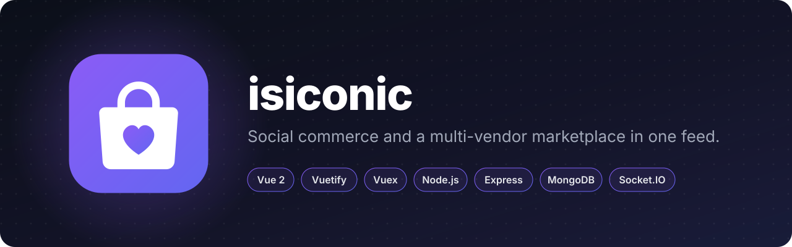
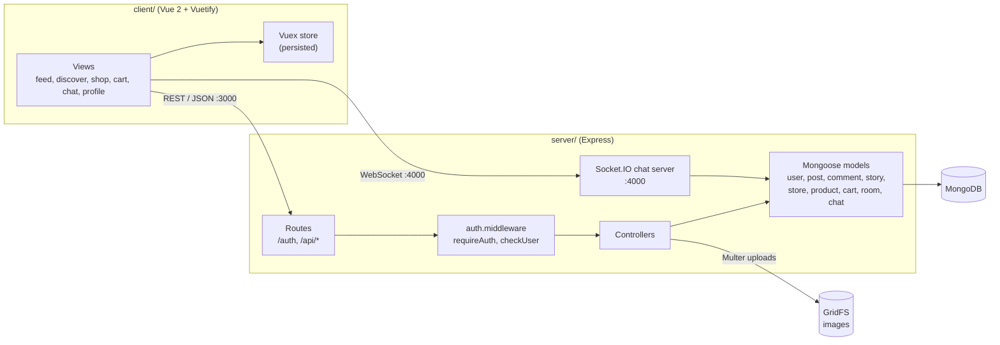

<div align="center">
  
  <p><b>A social commerce platform where shoppers follow, post and chat, and vendors run their own stores, all in one feed.</b></p>

  <p>
    
    
    
    
    
    <br />
    
    
    
    
    
  </p>

  <p><a href="#-quick-start">Quick start</a> · <a href="#-features">Features</a> · <a href="#-architecture">Architecture</a> · <a href="#-contributing">Contributing</a></p>
</div>

## Overview

isiconic combines a social network for online shoppers with a multi-vendor marketplace. Users share posts and stories, follow people and shops, react and comment, and chat in real time, while any user can open a store, list products and sell to the same community that discovers them in the feed.

It is built on the MEVN stack: a Vue 2 + Vuetify single-page app talking to an Express REST API backed by MongoDB, with Socket.IO for chat and GridFS for image storage. The project is in active development.

## ✨ Features

| Area | What it does |
| --- | --- |
| **Accounts** | Sign up, log in and log out with JWTs stored in an HTTP cookie, bcrypt-hashed passwords and Joi request validation. Editable profiles with avatars. |
| **Roles** | `user` and `admin` roles; admin-only endpoints for moderating posts. |
| **Social feed** | Create, edit and delete posts with images, tag them, and browse posts by tag. |
| **Engagement** | Like, dislike and love reactions; comments with replies; follow and unfollow users. |
| **Stories** | Image stories that expire automatically after 24 hours (MongoDB TTL index). |
| **Discover** | Browse posts, products, shops and users from one discovery view. |
| **Stores** | Any user can create a shop, edit it, and manage it from a "My shop" dashboard; public shop pages and a shops directory. |
| **Products** | Full product CRUD, listed per store and per seller, with product images. |
| **Cart** | Per-user cart: add and remove products and update quantities. |
| **Real-time chat** | Chat rooms and message history over Socket.IO. |
| **Media** | Image uploads for posts, users, products, stores and stories, stored in MongoDB GridFS via Multer. |

## 🧱 Tech stack

| Layer | Technology |
| --- | --- |
| Frontend | Vue 2, Vuetify 2, Vue Router 3, Vuex 3 with `vuex-persistedstate`, axios, Socket.IO client |
| Backend | Node.js, Express 4, Morgan, cookie-parser |
| Auth | jsonwebtoken (JWT in cookies), bcryptjs, Joi |
| Database | MongoDB with Mongoose 5 |
| Files | Multer, `multer-gridfs-storage`, GridFS |
| Real-time | Socket.IO 3 |
| Tooling | Vue CLI 4.5, ESLint, nodemon (optional) |

## 🏗 Architecture



Every `/api/*` request passes through the JWT middleware before reaching its router. Routers stay thin and delegate to controllers, which work with Mongoose models.

```text
server/
  bin/www          HTTP entry point (PORT, default 3000)
  server.js        Express app, MongoDB connection, route mounting
  middlewares/     JWT auth and role checks
  routes/          REST routers, including images_routes/ for GridFS uploads
  controllers/     Request handlers (posts, stores, products, cart, chat, ...)
  models/          Mongoose schemas
  helpers/         Validation, cart creation, chat helpers
client/
  src/views/       Pages: feed, discover, shop, user, chat, auth
  src/components/  Feed, story, shop, discover, chat and user components
  src/store/       Vuex modules
  src/router/      Vue Router configuration
```

## 🚀 Quick start

### Prerequisites

- [Node.js](https://nodejs.org/) and npm (a version compatible with Vue CLI 4.5 and Mongoose 5)
- A MongoDB instance, local or hosted (for example MongoDB Atlas)

### 1. Clone

```bash
git clone https://github.com/ismailbentabett/isiconic_web_app.git
cd isiconic_web_app
```

### 2. Configure and start the API

```bash
cd server
cp .env.example .env   # then fill in DB_URI and JWT_SECRET
npm install
npm start              # or: npx nodemon ./bin/www
```

The REST API listens on `http://localhost:3000` and the Socket.IO chat server on port `4000`.

### 3. Start the client

In a second terminal:

```bash
cd client
npm install
npm run serve
```

Open `http://localhost:8080`. The client calls the API at `http://localhost:3000` and the chat server at `http://localhost:4000`.

## ⚙️ Configuration

The server loads environment variables from `server/.env` via `dotenv`. See [`server/.env.example`](server/.env.example).

| Variable | Required | Description |
| --- | --- | --- |
| `DB_URI` | Yes | MongoDB connection string |
| `JWT_SECRET` | Yes | Secret used to sign and verify JWTs |
| `PORT` | No | HTTP port for the API (defaults to `3000`) |

The client has no environment file; API and socket URLs are set in the client source (`http://localhost:3000` and `http://localhost:4000`).

## 📁 Project structure

```text
isiconic_web_app/
├── client/                    # Vue 2 + Vuetify single-page app
│   └── src/
│       ├── views/             # Feed, discover, shop, user, chat, login, signup, 404
│       ├── components/        # Feed, story, shop, cart, chat, user, tags
│       ├── store/             # Vuex store
│       └── router/            # Routes
└── server/                    # Express REST API
    ├── bin/www                # Entry point
    ├── server.js              # App setup and route mounting
    ├── middlewares/           # Auth
    ├── routes/                # REST routes (+ images_routes/)
    ├── controllers/           # Business logic
    ├── models/                # Mongoose schemas
    ├── helpers/               # Validation and utilities
    └── .env.example           # Environment template
```

## 🗺 Roadmap

- [x] Accounts, JWT auth and admin role
- [x] Posts, tags, reactions, comments and replies
- [x] Follow system and 24-hour stories
- [x] Multi-vendor stores and product catalogue
- [x] Shopping cart
- [x] Real-time chat rooms
- [ ] Checkout and payments
- [ ] Order management for buyers and vendors
- [ ] Push and email notifications
- [ ] Configurable API and socket URLs on the client
- [ ] Automated tests and a CI workflow
- [ ] Docker setup for local development

## 🤝 Contributing

Contributions are welcome. Please read [CONTRIBUTING.md](CONTRIBUTING.md) for the workflow and conventions, and follow the [Code of Conduct](CODE_OF_CONDUCT.md).

## 🔒 Security

Please do not open public issues for security problems. See [SECURITY.md](SECURITY.md) for how to report a vulnerability privately.

## 📄 License

Released under the [MIT License](LICENSE).

---

<div align="center">
  <p>Built by <a href="https://github.com/ismailbentabett">Ismail Bentabett</a> · <a href="https://ismailbentabett.com">ismailbentabett.com</a></p>
  <p>⭐ Star this repo if you find it useful</p>
</div>
